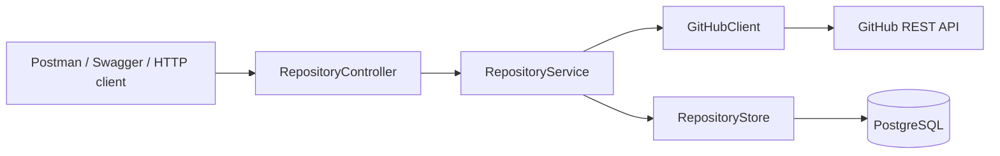

# GitHub Repository Searcher

A Java 21 and Spring Boot REST API for discovering GitHub repositories and working with saved repository data. Search results are persisted in PostgreSQL, where they can be filtered, sorted, and paginated without making another GitHub API call.

The project includes transactional batch upserts, input validation, upstream error handling, database migrations, automated tests, Docker configuration, and interactive API documentation.

## Project links

| Resource | Link |
|---|---|
| Source code | [GitHub repository](https://github.com/ankush-48/github-repository-searcher) |
| Live API base URL | [github-repository-searcher-symh.onrender.com](https://github-repository-searcher-symh.onrender.com) |
| Interactive API documentation | [Swagger UI](https://github-repository-searcher-symh.onrender.com/swagger-ui/index.html) |
| OpenAPI specification | [OpenAPI JSON](https://github-repository-searcher-symh.onrender.com/v3/api-docs) |
| Service health | [Health endpoint](https://github-repository-searcher-symh.onrender.com/actuator/health) |
| Saved repositories | [Browse stored results](https://github-repository-searcher-symh.onrender.com/api/github/repositories) |
| Example filtered query | [Java repositories with at least 100 stars](https://github-repository-searcher-symh.onrender.com/api/github/repositories?language=Java&minStars=100&sort=stars&page=0&size=20) |
| Build and test status | [GitHub Actions](https://github.com/ankush-48/github-repository-searcher/actions/workflows/ci.yml) |

The base URL identifies the backend service. It does not serve a custom homepage. Open Swagger UI to explore the API or use Postman, curl, or another HTTP client.

## Contents

- [Features](#features)
- [Technology](#technology)
- [Architecture](#architecture)
- [Quick start with Docker](#quick-start-with-docker)
- [Run with Java and Maven](#run-with-java-and-maven)
- [Configuration](#configuration)
- [API reference](#api-reference)
- [Persistence and consistency](#persistence-and-consistency)
- [Errors and validation](#errors-and-validation)
- [Postman](#postman)
- [Testing and coverage](#testing-and-coverage)
- [CI and deployment](#ci-and-deployment)
- [Health monitoring](#health-monitoring)
- [Project structure](#project-structure)
- [Troubleshooting](#troubleshooting)
- [Scope and tradeoffs](#scope-and-tradeoffs)
- [Further documentation](#further-documentation)

## Features

- Search GitHub repository names with an optional programming-language filter.
- Sort searches by stars, forks, or update time.
- Save the requested page of results to PostgreSQL.
- Update existing repositories by GitHub ID instead of creating duplicate rows.
- Protect newer snapshots from being overwritten by older responses.
- Retrieve saved data using case-insensitive language filtering, a minimum star count, sorting, and pagination.
- Return structured validation and upstream error responses.
- Handle empty results, GitHub rate limits, connection failures, and timeouts.
- Apply versioned schema changes automatically with Flyway.
- Expose Swagger UI, an OpenAPI specification, and a database-aware health endpoint.

## Technology

| Area | Implementation |
|---|---|
| Language | Java 21 |
| Application framework | Spring Boot 3.5.16 |
| HTTP API | Spring Web MVC, Jackson, Jakarta Bean Validation |
| GitHub integration | Spring RestClient and GitHub REST API |
| Persistence | Spring JDBC and PostgreSQL |
| Database migrations | Flyway |
| Connection pool | HikariCP |
| API documentation | springdoc-openapi 2.8.17 |
| Health checks | Spring Boot Actuator |
| Testing | JUnit 5, Mockito, MockMvc, MockRestServiceServer, real PostgreSQL integration tests |
| Coverage | JaCoCo |
| Build | Maven 3.9.11 via Maven Wrapper |
| Packaging and hosting | Docker, Docker Compose, Render |
| Continuous integration | GitHub Actions |
| External health monitoring | UptimeRobot |

The local and CI database containers use PostgreSQL 17. The application connects to a separate managed PostgreSQL database on Render.

## Architecture



| Component | Responsibility |
|---|---|
| `RepositoryController` | HTTP routes, request validation, and API documentation |
| `RepositoryService` | Search orchestration and GitHub search-window validation |
| `GitHubClient` | Encoded upstream requests, response mapping, response validation, and error translation |
| `RepositoryStore` | Parameterized SQL, transactional batch upserts, filtering, and pagination |
| `ApiExceptionHandler` | Consistent error responses that omit internal implementation details |

### Search request flow

1. Validate and normalize the request.
2. Request one page of repositories from GitHub.
3. Validate the complete upstream page before writing any rows.
4. Save the page in a short PostgreSQL transaction.
5. Read the canonical saved snapshots and return them in the search-result order.

The external HTTP request runs before the database transaction, so waiting on GitHub does not hold an open database transaction. Saved-result retrieval uses PostgreSQL only.

## Quick start with Docker

**Requirements:** Git, Docker, and Docker Compose v2. Java and Maven do not need to be installed on the host for this option.

```bash
git clone https://github.com/ankush-48/github-repository-searcher.git
cd github-repository-searcher
docker compose up --build -d
```

Compose starts PostgreSQL, waits for its health check, and starts the application. Flyway creates the schema automatically.

| Local resource | URL |
|---|---|
| Swagger UI | http://localhost:8080/swagger-ui.html |
| OpenAPI JSON | http://localhost:8080/v3/api-docs |
| Health | http://localhost:8080/actuator/health |
| Saved repositories | http://localhost:8080/api/github/repositories |

View logs and stop the services:

```bash
docker compose logs -f app
docker compose down
```

PostgreSQL data is stored in a named Docker volume and survives a normal `docker compose down`.

For optional local overrides, copy `.env.example` to `.env` and edit it before starting Compose. The defaults are intended for local development. Real credentials and `.env` files must remain outside version control.

## Run with Java and Maven

**Requirements:** JDK 21 and an available PostgreSQL database. The included Maven Wrapper downloads the configured Maven version, so a separate Maven installation is optional.

Start only the local database:

```bash
docker compose up db -d
```

Run the application on macOS or Linux:

```bash
./mvnw spring-boot:run
```

Run it in Windows PowerShell:

```powershell
.\mvnw.cmd spring-boot:run
```

To connect to an existing PostgreSQL installation instead, create a database and user, set the environment variables below, and run the same command. Spring Boot connects to the database and Flyway applies the migration; the application does not create the PostgreSQL database itself.

Build and run the executable JAR:

```bash
./mvnw -DskipTests package
java -jar target/github-repository-searcher-1.0.0.jar
```

On Windows, replace `./mvnw` with `.\mvnw.cmd`. The packaging example skips tests; use `verify` for full verification.

## Configuration

Configuration is defined in [`application.yml`](src/main/resources/application.yml) and can be overridden with environment variables.

| Variable | Default | Purpose |
|---|---|---|
| `DB_URL` | Built from the host, port, and database name below | Complete PostgreSQL JDBC URL; overrides the composed address |
| `DB_HOST` | `localhost` | Database host when `DB_URL` is absent |
| `DB_PORT` | `5432` | Database port when `DB_URL` is absent |
| `DB_NAME` | `reposearch` | Database name when `DB_URL` is absent |
| `DB_USERNAME` | `reposearch` | Database username |
| `DB_PASSWORD` | `reposearch` | Database password; local default only |
| `GITHUB_TOKEN` | Empty | Optional server-side GitHub token |
| `GITHUB_API_BASE_URL` | `https://api.github.com` | Upstream API address; override only for trusted testing |
| `PORT` | `8080` | Application HTTP port |

The default database address is `jdbc:postgresql://localhost:5432/reposearch`. A provider's `postgres://` or `postgresql://` connection string must be converted to JDBC format before using it as `DB_URL`. Add the provider's recommended TLS parameters where required.

GitHub public repository searches work without a token, subject to upstream limits. An optional token is configured privately on the server; clients do not send it to this API. Never put a real token in the README, a Postman collection, or a committed configuration file.

Default operational settings:

- GitHub connection timeout: **3 seconds**.
- GitHub read timeout: **10 seconds**.
- Maximum database pool size: **5 connections**.
- Database connection acquisition timeout: **10 seconds**.
- Graceful application shutdown enabled.

Compose reads `.env` for its configuration. Running the JAR or Maven directly requires setting environment variables in the shell or process environment; Spring Boot does not automatically load this project's `.env` file.

## API reference

| Method | Endpoint | Purpose |
|---|---|---|
| `POST` | `/api/github/search` | Search GitHub and persist one page |
| `GET` | `/api/github/repositories` | Query saved repository snapshots |
| `GET` / `HEAD` | `/actuator/health` | Check application and database health |
| `GET` | `/v3/api-docs` | Retrieve the OpenAPI specification |

### 1. Search GitHub and save results

**Endpoint:** `POST /api/github/search`

**Content type:** `application/json`

```json
{
  "query": "spring-boot",
  "language": "Java",
  "sort": "stars",
  "page": 1,
  "perPage": 5
}
```

| Field | Required | Default | Rules |
|---|---|---|---|
| `query` | Yes | None | Non-blank, up to 200 characters after trimming; letters, numbers, spaces, `.`, `_`, `/`, and `-` |
| `language` | No | No language filter | Up to 50 characters; letters, numbers, spaces, `+`, `#`, `.`, and `-`; blank becomes no filter |
| `sort` | No | `stars` | `stars`, `forks`, or `updated` |
| `page` | No | `1` | Integer from 1 to 1000, also subject to GitHub's accessible search window |
| `perPage` | No | `30` | Integer from 1 to 100 |

Searches are scoped to repository names using GitHub's `in:name` qualifier. GitHub search semantics determine matching; this is not a custom arbitrary-substring search engine. The optional language qualifier is URI encoded, including names such as `C++`. Sorting is descending.

GitHub exposes at most the first **1000** search results. This API rejects pages starting beyond that window; GitHub can also reject a requested page/window with HTTP 422. One call imports only its requested page, not every repository matching the query.

Example request against the live service:

```bash
curl -X POST 'https://github-repository-searcher-symh.onrender.com/api/github/search' \
  -H 'Content-Type: application/json' \
  -d '{"query":"spring-boot","language":"Java","sort":"stars","page":1,"perPage":5}'
```

Windows PowerShell:

```powershell
$body = @{
    query = 'spring-boot'
    language = 'Java'
    sort = 'stars'
    page = 1
    perPage = 5
} | ConvertTo-Json

Invoke-RestMethod `
    -Uri 'https://github-repository-searcher-symh.onrender.com/api/github/search' `
    -Method Post -ContentType 'application/json' -Body $body
```

Illustrative successful response, HTTP 200:

```json
{
  "message": "Repositories fetched and saved successfully",
  "repositories": [
    {
      "id": 123456,
      "name": "spring-boot-example",
      "description": "Example repository description",
      "owner": "example-owner",
      "language": "Java",
      "stars": 450,
      "forks": 120,
      "lastUpdated": "2026-01-01T12:00:00Z",
      "htmlUrl": "https://github.com/example-owner/spring-boot-example"
    }
  ],
  "totalCount": 1,
  "incompleteResults": false,
  "page": 1,
  "perPage": 5
}
```

The sample repository is illustrative. Actual results and statistics change over time.

- `totalCount` describes the upstream GitHub search, not the number of rows saved by this call.
- `repositories` contains the requested page's canonical stored snapshots.
- `incompleteResults` preserves GitHub's indication that its search results may be incomplete.
- `description` and `language` can be `null`.
- An empty search returns HTTP 200 with an empty repository array and writes no rows.
- Success is returned after database persistence completes.

### 2. Retrieve saved repositories

**Endpoint:** `GET /api/github/repositories`

```bash
curl 'https://github-repository-searcher-symh.onrender.com/api/github/repositories?language=Java&minStars=100&sort=stars&page=0&size=20'
```

| Parameter | Default | Behavior |
|---|---|---|
| `language` | No filter | Case-insensitive language equality; maximum 50 characters |
| `minStars` | No filter | Non-negative minimum star count, inclusive |
| `sort` | `stars` | `stars`, `forks`, or `updated`, descending |
| `page` | `0` | Zero-based page index, maximum 1,000,000 |
| `size` | `20` | Page size from 1 to 100 |

All parameters are optional. Equal sort values are ordered by GitHub ID ascending for deterministic results.

Illustrative response when no saved rows match:

```json
{
  "repositories": [],
  "totalElements": 0,
  "page": 0,
  "size": 20,
  "totalPages": 0
}
```

Non-empty results use the same repository object fields as the search response. `totalElements` counts all saved rows matching the filters, while `repositories` contains only the requested local page. An out-of-range page returns an empty array.

**Pagination differs between endpoints:** GitHub search starts at page **1**; stored-result retrieval starts at page **0**.

This operation reads PostgreSQL without calling GitHub, so upstream GitHub availability and quotas do not affect retrieval while the database remains healthy.

## Persistence and consistency

The [`V1 Flyway migration`](src/main/resources/db/migration/V1__create_repositories.sql) creates one `github_repositories` table.

| Column | PostgreSQL type | Meaning |
|---|---|---|
| `id` | `BIGINT`, primary key | Unique GitHub repository ID |
| `name` | `VARCHAR(255)` | Repository name |
| `description` | `TEXT`, nullable | Repository description |
| `owner` | `VARCHAR(255)` | Owner login |
| `language` | `VARCHAR(100)`, nullable | Primary language |
| `stars` | `BIGINT` | Non-negative star count |
| `forks` | `BIGINT` | Non-negative fork count |
| `last_updated` | `TIMESTAMPTZ` | Upstream GitHub update time |
| `html_url` | `TEXT` | Repository URL |
| `fetched_at` | `TIMESTAMPTZ` | Fetch start time used for freshness ordering |

### Duplicate prevention

The database primary key enforces uniqueness. Native `INSERT ... ON CONFLICT (id) DO UPDATE` handles repeated and overlapping searches without a read-before-write existence check for every repository.

### Atomic writes and freshness

A page is written in one transaction. A database constraint failure rolls back the entire batch. Older GitHub update timestamps cannot overwrite newer snapshots; when update timestamps match, the later fetch start time wins.

This is a best-effort freshness policy. GitHub's repository update timestamp is not a version counter for every statistic, so it is not a guarantee of perfect ordering for every possible upstream change.

### Query safety and indexes

Filter values are bound SQL parameters. Sort column names come from a closed enum, never arbitrary request text. Indexes support stars, forks, update time, and case-insensitive language plus stars. A read-only repeatable-read transaction gives each saved-result query a consistent snapshot for its row count and page.

## Errors and validation

Error responses use a consistent JSON structure:

```json
{
  "timestamp": "2026-01-01T00:00:00Z",
  "status": 400,
  "code": "VALIDATION_ERROR",
  "message": "Request validation failed",
  "path": "/api/github/search",
  "details": [
    "query: must not be blank"
  ]
}
```

| HTTP status | Meaning |
|---|---|
| `400` | Invalid request fields, JSON, parameter types, sort values, pagination, or search window |
| `404` | Unknown route |
| `405` | Unsupported HTTP method |
| `415` | Unsupported request content type |
| `422` | GitHub rejected the query or requested search window |
| `500` | Unexpected internal failure |
| `502` | Invalid upstream payload, upstream failure, connection failure, or upstream credential rejection |
| `503` | GitHub rate limit or temporary database failure |
| `504` | GitHub request timed out |

Validation rejects unknown JSON request fields and fractional values for integer pagination fields. Extra fields in GitHub's own response are ignored, while required repository data is checked before persistence.

For detected GitHub rate limits, the API returns `GITHUB_RATE_LIMITED` with a `Retry-After` header, using upstream timing when available and a fallback otherwise. The status is 503 because the exhausted quota belongs to an upstream dependency. Requests are not automatically retried.

Error responses omit raw SQL, credentials, stack traces, and upstream response bodies.

## Postman

Import the collection and one environment:

- [API collection](docs/postman/Repository-Searcher.postman_collection.json)
- [Local environment](docs/postman/Local.postman_environment.json)
- [Deployed environment](docs/postman/Deployed.postman_environment.json)

Select the environment in Postman. Its `baseUrl` selects either `http://localhost:8080` or the hosted API; no GitHub token belongs in the client environment.

The numbered requests cover health, search, saved filters, repeated search, alternate sorts, empty results, and invalid requests. Requests 04–06 compare stored counts around a repeated search. They assume unchanged live search results and no concurrent imports; GitHub's live result set can change.

## Testing and coverage

### Unit, MVC, and HTTP-client tests

These tests use mocked dependencies or a mocked HTTP transport and require neither PostgreSQL nor a live GitHub connection:

```bash
./mvnw test
```

### Full verification with PostgreSQL

```bash
docker compose -f compose.test.yml up -d --wait
./mvnw verify
docker compose -f compose.test.yml down
```

The integration profile connects to a dedicated test database:

| Variable | Default |
|---|---|
| `TEST_DB_URL` | `jdbc:postgresql://localhost:55432/reposearch_test` |
| `TEST_DB_USERNAME` | `reposearch` |
| `TEST_DB_PASSWORD` | `reposearch` |

Integration tests truncate the repository table. Use a disposable database and never set `TEST_DB_URL` to a production database.

### Verified results

The verification recorded on **12 November 2026** produced:

| Check | Result |
|---|---|
| Unit, MVC, and HTTP-client tests | 62 passed |
| PostgreSQL and end-to-end integration tests | 11 passed |
| Total automated tests | **73 passed** |
| Line coverage | **98.82%** |
| Branch coverage | **77.36%** |
| Postman collection, local and deployed API | 12 requests and 14 assertions passed in each run |

The build enforces minimum coverage of **90% lines** and **70% branches**. These are recorded results, not a promise that future code changes have the same coverage. See the latest workflow and [`VERIFICATION.md`](docs/VERIFICATION.md) for context.

Coverage includes validation, nullable fields, URL encoding, malformed upstream responses, timeouts, rate-limit translation, stable ordering, pagination, atomic rollback, stale snapshots, SQL injection as data, and concurrent writers. Automated tests do not consume GitHub API quota.

Generated reports:

- Unit and MVC results: `target/surefire-reports/`
- Integration results: `target/failsafe-reports/`
- JaCoCo HTML: `target/site/jacoco/index.html`

Reports are also uploaded as artifacts by GitHub Actions.

## CI and deployment

### GitHub Actions

The [build workflow](.github/workflows/ci.yml) runs on pushes and pull requests. It provisions PostgreSQL, runs Maven `verify`, uploads test and coverage reports, and builds the production Docker image. Workflow results are available in [Actions](https://github.com/ankush-48/github-repository-searcher/actions).

### Docker image

The [Dockerfile](Dockerfile) uses a Maven build stage and a Java 21 runtime stage. The final application runs as a non-root user. The container accepts database configuration through environment variables and listens on `PORT`, defaulting to 8080.

### Render

The live service is hosted on Render with a managed PostgreSQL database. The [`render.yaml`](render.yaml) Blueprint declares both resources and supplies database host, port, name, username, and password to the application through provider-managed environment variables.

For another deployment:

1. Connect your repository to Render and create a Blueprint from `render.yaml`, reviewing the offered plans before provisioning.
2. Alternatively, create a Docker web service and PostgreSQL database manually, then set the JDBC URL and credentials from the configuration table.
3. Set the health-check path to `/actuator/health`.
4. Add `GITHUB_TOKEN` privately only if needed.
5. Wait for the service to become healthy and verify the search and saved-query endpoints.

The deployment guide contains additional [hosting configuration details](docs/DEPLOYMENT.md).

## Health monitoring

An UptimeRobot HTTP(s) monitor is configured for the deployed health endpoint, with a **5-minute interval** and the default **HEAD** method:

```text
https://github-repository-searcher-symh.onrender.com/actuator/health
```

The monitor was shown as **Up** when configured. Checks run externally and do not require a browser or local computer to remain open. Monitoring the health endpoint does not invoke GitHub search or consume its search quota. A GET request to the same endpoint returns health JSON; a HEAD request checks the HTTP response without its body.

Regular inbound requests should reduce inactivity spin-downs. They do not guarantee uninterrupted availability or prevent provider restarts, quota exhaustion, database expiry, or maintenance.

Render's free-tier constraints remain relevant:

- Free services can spin down after 15 minutes without inbound traffic.
- The workspace shares **750 free instance hours per calendar month** across its free web services. Keeping multiple services awake continuously can exhaust that allowance.
- Free PostgreSQL databases expire **30 days after creation**. External monitoring does not extend that lifetime.

See [Render's free-service documentation](https://render.com/docs/free) for current limits. Check the actual database expiry and workspace usage in your hosting account.

## Project structure

```text
.
├── .github/workflows/ci.yml        # CI tests, reports, and Docker build
├── .mvn/wrapper/                   # Maven Wrapper configuration
├── docs/
│   ├── ARCHITECTURE.md             # Design decisions and consistency model
│   ├── DEPLOYMENT.md               # Hosting setup
│   ├── VERIFICATION.md             # Recorded verification results
│   └── postman/                    # Collection and local/deployed environments
├── src/main/java/com/ankush/reposearch/
│   ├── api/                       # Controller and request/response records
│   ├── config/                    # HTTP client and configuration properties
│   ├── domain/                    # Repository snapshot and sort keys
│   ├── error/                     # Exceptions and centralized error responses
│   ├── github/                    # Upstream GitHub API client
│   ├── persistence/               # PostgreSQL queries and upserts
│   └── service/                   # Application orchestration
├── src/main/resources/
│   ├── application.yml
│   └── db/migration/              # Flyway schema migrations
├── src/test/                      # Unit, MVC, client, and integration tests
├── compose.yml                    # Local application and PostgreSQL
├── compose.test.yml               # Dedicated integration-test database
├── Dockerfile
├── pom.xml
└── render.yaml
```

## Troubleshooting

| Symptom | What to check |
|---|---|
| Root URL returns 404 | Use `/swagger-ui/index.html` or an API endpoint; the backend has no custom homepage |
| First hosted request is slow | Allow time for a cold start; monitoring cannot prevent every restart or suspension |
| Saved results are empty | Run a successful search first, or relax filters; retrieval never imports data by itself |
| Search returns 503 with `GITHUB_RATE_LIMITED` | Respect `Retry-After`; optionally configure a private server-side token |
| Search returns 422 | Narrow the query or reduce the requested page/window |
| Search returns 502 | Check upstream availability and any configured token; the API intentionally hides raw upstream error bodies |
| Health is DOWN or database access fails | Check database availability, JDBC URL, credentials, network settings, and hosted expiry |
| Local database cannot bind its port | Check whether port 5432 is already in use; the test database uses 55432 |
| `verify` fails to connect to PostgreSQL | Start `compose.test.yml` and check the `TEST_DB_*` variables |
| A request unexpectedly returns 400 | Check allowed field names, sort values, number types, and page bounds; unknown JSON fields are rejected |
| Environment changes are not applied | Restart the application, or recreate the Compose application container with the updated environment |

## Scope and tradeoffs

- Repository data is a snapshot refreshed when that repository appears in a subsequent search; there is no background synchronization.
- Search imports one requested page and remains subject to GitHub's upstream quotas and search semantics.
- Local pagination uses offsets. Cursor pagination would be a better fit for very deep result traversal.
- The public API does not implement authentication, per-caller request quotas, or automatic retention limits. A production deployment should add these according to its requirements.
- SQL indexes help common access patterns, but not every filter and sort combination is guaranteed to avoid a sort operation.
- No cache or automatic upstream retries are used. Saved-result retrieval provides a separate database read path when GitHub is unavailable.

## Further documentation

- [Architecture and design decisions](docs/ARCHITECTURE.md)
- [Deployment guide](docs/DEPLOYMENT.md)
- [Verification record](docs/VERIFICATION.md)
- [Postman collection](docs/postman/Repository-Searcher.postman_collection.json)
- [Local Postman environment](docs/postman/Local.postman_environment.json)
- [Deployed Postman environment](docs/postman/Deployed.postman_environment.json)
- [GitHub REST search documentation](https://docs.github.com/en/rest/search)
- [Render free-service limits](https://render.com/docs/free)

Maintained by [Ankush Yadav](https://github.com/ankush-48).
