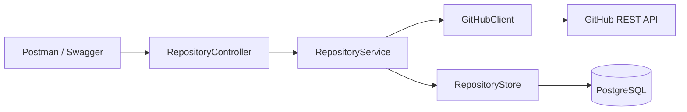

# Architecture and decisions

## Responsibilities

- Controller: HTTP contract, Bean Validation and OpenAPI descriptions.
- Service: orchestration and the upstream search window restriction.
- GitHub client: URI encoding, response mapping, validation, timeouts and safe upstream error translation.
- Store: parameterized SQL, batch upserts, stable sorting and transactional persistence.
- Exception advice: consistent JSON errors without raw upstream bodies, SQL or credentials.

## Why JDBC rather than JPA?

The main write operation is a PostgreSQL `INSERT ... ON CONFLICT DO UPDATE`. JDBC expresses this directly and avoids a read-before-write race and one database lookup per repository. JPA would also be reasonable, but adds little value for a single table and two operations.

## Request lifecycle and consistency

Search validates the request, records its start time, calls GitHub, and validates the entire response before opening a database transaction. The store batches at most 100 records, then reads the canonical snapshots back in the same transaction. A constraint failure rolls back the entire batch. GitHub ID is the primary key, so overlapping searches remain unique under concurrency.

An older GitHub `updated_at` cannot replace a newer snapshot. For equal timestamps, the later-started fetch wins. This is a best-effort freshness policy: GitHub's repository update timestamp is not a version counter for every statistic, and concurrent readback can observe another valid committed snapshot. No claim of distributed linearizability is made.

Stored retrieval uses a read-only repeatable-read transaction so count and records share a consistent database snapshot. Sort columns come only from an enum; filter values are SQL parameters. Ties sort by GitHub ID ascending. Case-insensitive language filtering has a matching expression index.

## Deliberate scope

- No frontend, authentication system, background jobs or cache: these are outside the assignment.
- Search imports one requested page, not every matching repository. The response exposes GitHub's total count and incomplete-results flag.
- Search is one-based; local stored-result pagination is zero-based. Each is documented explicitly.
- No automatic retries: repeated search calls can make rate limits worse. Retry timing is returned when GitHub supplies it.
- A successful empty search writes nothing and returns HTTP 200 with an empty array.
- Stored data is a snapshot, refreshed only when that repository appears in another search.
- The public assessment API has no authentication. For production, add authentication, ingress rate limiting, request-size limits, observability and a retention policy. An optional GitHub token is server-side only.

## Complexity and tradeoffs

Each search persists at most 100 records. Retrieval is bounded to 100 rows per page. SQL indexes support common filter/sort paths; there is no claim that all filter/sort combinations avoid sorting. Offset pagination is simple for this assessment, but deep pagination should use a cursor. There is no unbounded in-memory import.

## Testing strategy

Unit tests verify orchestration and upstream HTTP behavior using a mocked transport. MVC tests exercise JSON validation and safe error responses. Integration tests use actual PostgreSQL and Flyway, checking native upsert semantics, transaction rollback, concurrent writers, null fields, ordering, filtering and pagination. CI also builds the production Docker image. GitHub is not called by automated tests, making them deterministic and independent of API quotas.
